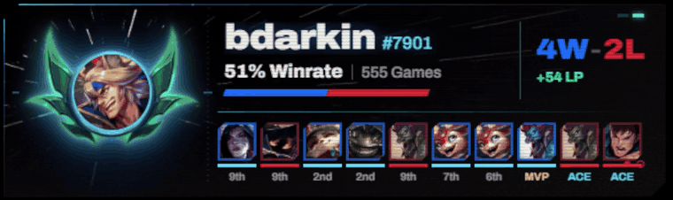
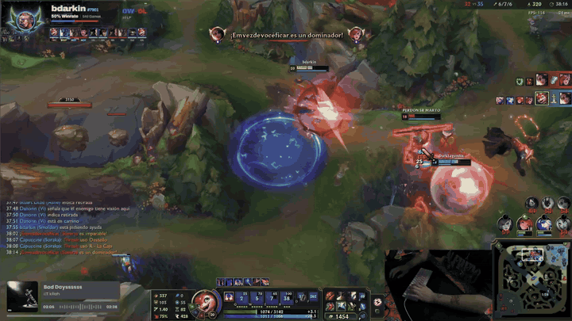
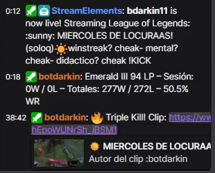

# LoL Stream Tools

Herramientas en Python para streamear League of Legends y TFT. Resuelven un problema concreto: mostrar en stream el rango, los LP y el historial de la sesion sin actualizarlos a mano, y no perderse ningun multikill sin clipear.

## Demo

**Overlay en OBS** (rango, LP, winrate y ultimas partidas, con rotacion y efecto glitch):

**Clip automatico en una triple kill:** el bot detecta el multikill con la Live Client Data API, crea el clip en Twitch y publica el link en el chat.

Videos completos: [overlay](docs/demo-overlay.mp4) · [triple kill y clip](docs/demo-clip-automatico.mp4)

> Es una herramienta de escritorio que corre en la PC del streamer, por eso no tiene URL publica.

## Que incluye

| Modulo | Que hace |
|---|---|
| `scout/` | Bot principal. Consulta la API de Riot cada 30 s, genera un overlay con rango, LP y partidas, responde `!rank` / `!rango` / `!elo` en el chat (EventSub WebSocket) y detecta Triple/Quadra/Penta kills con la Live Client Data API para crear clips de Twitch y disparar OBS. |
| `trackers/scripts/tracker_ingame.py` | Overlay in-game: rango, LP ganados en la sesion, victorias/derrotas del dia e historial. |
| `trackers/scripts/tracker_rotativo.py` | Overlay rotativo con varias "slides" de estadisticas. |
| `trackers/scripts/tracker_tft.py` | Overlay equivalente para Teamfight Tactics. |
| `trackers/previews/` | Exploraciones de diseño de los overlays (HTML estatico, se abren en el navegador). |
| `launcher/` | Scripts `.bat` para instalar y arrancar todo junto en Windows. |

Cada overlay es un HTML independiente, asi que se puede asignar a una escena distinta de OBS como "Fuente de navegador".

## Tech Stack

Python · Riot Games API · Twitch API (OAuth, EventSub, Clips) · OBS WebSocket · HTML / CSS / JavaScript

## Agentic Workflow

Este proyecto se construyo con desarrollo asistido por IA (Claude), con el autor dirigiendo, revisando y aprobando cada cambio.

- **Arquitectura de contexto:** el trabajo se dividio en modulos independientes (un archivo por responsabilidad en `scout/`, un script por overlay) y cada rediseño se hizo como una version nueva, dejando la anterior como respaldo hasta validarla en stream.
- **Directivas de seguridad:** ninguna credencial vive en el codigo. Antes de publicar se audito el repo completo (claves, tokens, rutas locales y datos de cuenta) y toda la configuracion se unifico en un solo `launcher/.env` excluido por `.gitignore`.
- **Testing:** cada version se valido manualmente en stream y con previews HTML antes de reemplazar a la anterior. Todavia no hay una suite de tests automatizados; es el siguiente paso pendiente.

## Local Setup (Windows)

1. Instalar Python 3.10+.
2. Ejecutar `launcher\setup.bat` (crea el entorno de `scout` e instala dependencias).
3. Completar `launcher\.env` con tus credenciales (se crea a partir de `.env.example`).
4. Ejecutar `launcher\iniciar_stream_tools.bat`.
5. En OBS, agregar como fuente de navegador `scout/overlay.html` y los HTML de `trackers/overlays/`.

El tema del tracker in-game usa un video de fondo opcional (`fondo_warp.webm` / `fondo_warp.mp4`) que va en `trackers/overlays/` y no se incluye en el repo. La key de desarrollo de Riot vence cada 24 horas y se actualiza solo en `launcher/.env`.

## Aviso

Este proyecto no esta respaldado por Riot Games ni refleja sus opiniones. League of Legends y Teamfight Tactics son marcas de Riot Games, Inc.
